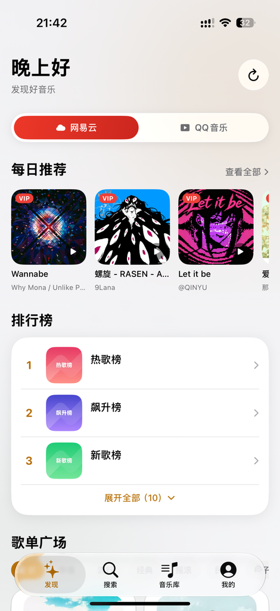

# Sherry 🎵

> 一款基于 **iOS 26 原生液态玻璃（Liquid Glass）** 的第三方音乐播放器（最低支持 iOS 26.1），**酷狗音乐专版**，纯 SwiftUI 实现。
> 本软件完全开源，仅供学习研究使用；组合发行版按 GPL-3.0-only 发布。

[](LICENSE)
[]()
[]()

## 🧑‍💻 关于 Sherry

- Sherry 是 [Beans Music](https://github.com/XIaodou0416/Beans-Music) 的酷狗专版分支（Co 2.0.3）：只走酷狗音乐，带逐字歌词同步、灵动岛与自适应音质
- 组合发行版按 GPL-3.0-only 发布；Beans 原有 MIT 版权声明及第三方许可证仍按 `THIRD_PARTY_NOTICES.md` 保留

## 📱 界面预览

<p align="center">
  
  
</p>
<p align="center">
  
  
</p>
<p align="center">
  
  
</p>
<p align="center">
  
  
</p>

---


## 🎨 核心卖点：DIY 美化，你的播放器你做主

这不是一个"长什么样就什么样"的播放器——**从全局主题到播放器每一个组件，全部都可以自定义**。

**全局主题，一键换肤**
- 内置 9 套主题色：琥珀暖金 / 青碧湖绿 / 樱粉 / 星蓝 / 罗兰紫 / 赛博青 / 蜜桃粉 / 鎏金黑 / 翡翠绿
- 不满意？打开**色盘**，任意颜色随便选，整个 App 的强调色、按钮、进度条、文字高亮全部跟随
- 主题模式跟随系统 / 浅色 / 深色，深浅色两套观感分别适配

**壁纸库：你的背景你做主**
- 上传**多张**自定义壁纸，自动存入壁纸库，随时在库中切换替换，不用反复去相册
- 支持浅色 / 深色两套背景，暗色壁纸不再发黑
- 全局背景同步：主页、搜索、音乐库、「我的」一键同步同一套背景

**全局 UI 样式**
- 内置默认柔和、清透简洁、紧凑淡雅、描边高亮等样式
- 底栏、卡片、播放器、弹窗全部跟随，质感统一

**播放器底部布局：自由拖动**
- 进度条、控制按钮、指示线支持 **XY 自由拖动 + 缩放**，摆到任何你喜欢的位置
- 调整时有**悬浮窗实时预览**，边调边看效果，一键恢复默认
- 指示线位置、显示开关均可单独控制

**歌词：专业级 DIY**
- 颜色：当前行 / 未播放行 / 发光颜色，色盘任选；渐变起止色自由搭配
- 效果：发光强度、模糊起始距离与模糊强度、辉光全可调
- 排版：字号、行距、显示行数、对齐（居中 / 居左）、位置重心全可调
- 3D 立体倾斜：上下后仰 + 左右倾斜，营造空间感
- 长按多选复制歌词、歌词翻译、逐行跟随、点击跳转

**进度条与氛围**
- 4 种进度条样式：流光 / 辉光 / 极光 / 波浪，带渐变辉光效果
- DJ 节奏脉冲光效，随旋律律动
- 圆形封面模式 + 自动旋转，封面点击切换歌词视图

**一键备份你的全部设置**
- 主题、配色、歌词效果、播放器布局、音质等所有自定义配置
- 一键导出为 JSON 分享 / 一键导入恢复，换机不再重新调

---

## 🚀 酷狗专版，一个 App 听酷狗

- 酷狗音乐专版：每日推荐、排行榜、推荐歌单、搜索、热门搜索全部走酷狗
- 酷狗：扫码登录 + 应用内网页登录 / Cookie 导入，同步歌单、收藏与 VIP 标识
- 酷狗歌曲评论区、KRC 逐字歌词、歌手主页
- 歌词子系统 2.2.0 重建：匿名酷狗链 → LRCLIB 兜底，候选字典序匹配（标题/歌手/时长 ±3s），磁盘缓存 30 天 / 负缓存 24 小时，行级歌词合成逐字扫掠，锚点 + 外推歌词时钟；支持本首歌单独偏移校正

## 🎧 播放器：从封面里长出来的界面

- 动态封面取色：背景渐变、进度条、播放按钮、功能按钮、歌词高亮全部实时跟随专辑封面主色，切歌平滑过渡
- 抖音式上下滑动切歌，过渡动画丝滑；左右滑动也可切换
- 封面点击切换歌词视图（封面飞入左上角动画）、圆形封面模式 + 自动旋转
- 底部指示线上滑呼出评论区（酷狗评论）

## ⚡ 播放能力拉满

- 5 档音质（标准 / 较高 / 极高 / 无损 / Hi-Res），无损与 Hi-Res 自动回落
- 中途连续卡顿自动降档（Hi-Res→无损→极高→标准）
- 锁屏控制、控制中心、后台播放、播放队列与插队、倍速（0.5x~2.0x）、循环模式、±15 秒、睡眠定时
- 播放历史、本地常听排行（按真实播放次数）

## 📱 系统体验

- iOS 26 原生液态玻璃（Liquid Glass）TabBar，与系统 App 一致
- 首次进入引导（欢迎 / DIY 美化 / 酷狗专版 / 免责确认）+ 版本更新说明弹窗 + 更新日志
- 软件使用说明、深浅色自适应

---

## 📂 工程结构

```
Beans/
├── BeansApp.swift                应用入口（首次使用引导页 + 免责确认）
├── RootView.swift                底部 Tab 液态玻璃导航 + 迷你播放器
├── DiscoverView.swift            发现页（每日推荐 / 排行榜 / 推荐歌单）
├── SearchView.swift              搜索（网易云 / QQ 切换 / 热搜）
├── LibraryView.swift             音乐库（歌单 / 本地音乐库 / 最近播放）
├── ProfileView.swift             我的（功能 / 听歌排行 / 使用说明 / 设置）
├── PlayerView.swift              播放器（动态取色 / 歌词 / 底部控制 / 设置）
├── PlayerManager.swift           播放核心（队列 / 倍速 / 定时 / 历史 / 下一首预取 / 429 熔断）
├── KugouMusicAPI.swift           酷狗接口（搜索 / 播放地址 / 评论 / 登录）
├── SherryLyricsService.swift / SherryKugouLyrics.swift / SherryLRCLIB.swift   歌词链路（缓存 → 酷狗匿名 → LRCLIB）
├── SherryLyricsCache.swift / SherryLyricsMatcher.swift / SherryLyricsSyncEngine.swift   歌词缓存 / 候选匹配 / 同步时钟
├── KugouMusicAuth.swift / KugouLoginSheet.swift   酷狗登录（扫码 + 网页登录）
├── Folia/                        歌词舞台渲染（Classic / Still / 云阶 / 绘光 / 浮名）
├── AuthStore.swift / Models.swift   登录态与数据模型
├── Theme.swift / CoverPalette.swift   全局主题与封面取色
├── PlayerLayout.swift / PlayerAmbience.swift / DJVisualView.swift   布局与氛围
├── ArtistHomeSheet.swift / CoHotCommentsSheet.swift   歌手主页与酷狗评论
├── Changelog.swift / Components.swift / SongCell.swift   日志与组件库
└── Assets.xcassets                图标与资源
```

---

## 🔨 构建

GitHub Actions（`Build Unsigned IPA`）自动构建：推送到 main 时构建并发布 Release；手动触发默认只构建不发布。

本地构建（需要 Mac + Xcode 26）：

```bash
brew install xcodegen
xcodegen generate
xcodebuild -project Sherry.xcodeproj -scheme Sherry -configuration Release \
  -sdk iphoneos -derivedDataPath build \
  CODE_SIGNING_ALLOWED=NO CODE_SIGNING_REQUIRED=NO CODE_SIGN_IDENTITY="" build
mkdir -p Payload
cp -R build/Build/Products/Release-iphoneos/Sherry.app Payload/
ditto -c -k --sequesterRsrc --keepParent Payload Sherry-unsigned.ipa
```

## 📲 安装

未签名 IPA 需自行签名安装：Sideloadly / AltStore / 爱思助手，使用 Apple ID 签名（免费自签 7 天有效）。
- 支持 iOS 26.1+
- Bundle ID：`com.kugou.kugou1002`（与酷狗音乐官方 App 相同包名；两者不可共存，安装会互相覆盖）

---

## ⚠️ 免责声明

- 本应用仅供个人学习研究使用，禁止用于商业及非法用途，如产生法律纠纷与作者无关
- 音乐 API 来源于 GitHub 开源项目（非官方版 API），本软件不提供任何音频存储服务
- 音乐版权归各平台所有，请支持正版；如需下载音频请在各平台官方渠道购买
- “酷狗音乐”等文字、图形和商业标识，其著作权或商标权归酷狗音乐 / 腾讯音乐娱乐相关权利方所有
- 具体内容请参考各平台用户协议

## 📄 License

[GPL-3.0-only](LICENSE) © 2026 XIaodou0416；Beans 原有 MIT 版权声明与第三方许可证见 `THIRD_PARTY_NOTICES.md`。

**开源说明：** 本项目为开源软件，代码公开透明，接受 Issue 反馈与 Fork 学习。非官方 API 属逆向学习范畴，请尊重各平台服务条款，合理使用。
